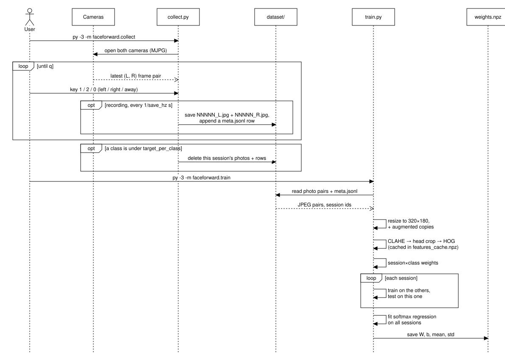
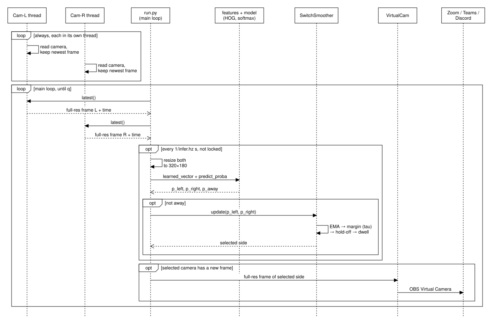

# FaceForward

Two webcams in, one virtual camera out, for Zoom, Teams, Discord, or anything else that takes a webcam.

If you work across two monitors with a webcam on each, people on a call end up seeing the side of your face half the time. FaceForward watches both cameras and sends whichever you're facing to a single virtual camera. It decides using a small model you train on your own photos, so it learns your camera placement, room and lighting. 

Any two USB webcams that show up in Windows should work, matching or not. I built it with a Logitech C922 on the left monitor and a Logitech C930e on the right, so that's what the defaults in `config.yaml` are set for.

The trained model (`weights.npz`) and the photos used to train it aren't included, since they're pictures of me. You collect your own and train in steps 4 and 5 below as it only takes a few minutes.

## Requirements

- **Windows.** The cameras and the virtual camera have to be on native Windows. It exits on macOS, Linux and WSL.
- **Two USB webcams**, one on each monitor, each pointed roughly at where your head is when you look at that screen. The default capture is 1080p30. Lower the resultion in `config.yaml` if your cameras or USB ports show signs of latency or frame drops.
- **Python 3.11+**
- **OBS Studio**, which provides the virtual camera driver. Open it once and click **Start Virtual Camera**. On current versions you can close OBS afterwards and the device stays available.
- **Python packages**, listed in `DEPENDENCIES.txt`:

| Package | Used for |
|---|---|
| `numpy` ≥ 1.24 | Feature extraction and model training |
| `opencv-python` ≥ 4.8 | Camera capture, image processing, preview windows |
| `pyvirtualcam` ≥ 0.11 | Sending frames to the OBS virtual camera |
| `pyyaml` ≥ 6.0 | Reading `config.yaml` |
| `pygrabber` ≥ 0.1 (Windows only) | Reading camera names, so left and right can be matched by name instead of USB plug order |

You don't need scikit-learn, PyTorch or a GPU.

## Setup

**1. Install** Python and OBS, and start the OBS virtual camera once.

**2. Install the packages in DEPENDENCIES.txt**


**3. Tell it which camera is which:**

```
py -3 -m faceforward.devices
```

This lists your cameras, marks which one it picked for LEFT and RIGHT, and shows a frame from each. If it got them wrong, set `name_contains` in `config.yaml` to part of each camera's name (not case-sensitive):

```yaml
left:
  name_contains: "C922"    # Logitech C922 on the left monitor
right:
  name_contains: "C930"    # Logitech C930e on the right monitor
```

Other examples: `"Brio"`, `"Kiyo"`, `"LifeCam"`, or `"Integrated"` for a laptop camera. If no name matches, `fallback_index` is used.

With **two identical cameras**, give both the same `name_contains`. The first match becomes left and the second becomes right. If they come out backwards, swap their USB ports, or set both `name_contains` to `"none"` and use `fallback_index` with the numbers `faceforward.devices` printed.

While you're in `config.yaml`, adjust each camera's `roi` (shown as a cyan box in the collect and run windows) so it surrounds where your head sits in that camera's view.

**4. Collect training photos:**

```
py -3 -m faceforward.collect
```

Press `1` while looking at the left monitor, `2` for the right, and `0` for looking away (phone, desk, ceiling). Press the same key again or space to stop. Keep moving around a bit and keep your head inside the cyan boxes.

Each run is one session. Get about 100 photos of each of the three classes; the window shows your progress. If you quit before all three reach the goal, that session is thrown out (`collect.discard_incomplete`). Several short sessions at different times of day, chair positions, outfits, with and without headphones, work much better than one long one.

**5. Train:**

```
py -3 -m faceforward.train
```

This prints how accurate the model is on each session it didn't train on, then writes `weights.npz`.

**6. Run:**

```
py -3 -m faceforward.run
```

In video conferance software, pick **OBS Virtual Camera** as your camera. Your microphone isn't affected.

| Key | Action |
|---|---|
| `[` / `]` | Force left / right |
| `l` | Lock the current camera |
| `-` / `+` | Dwell time −/+ 0.1 s |
| `9` / `0` | Hold-off −/+ 0.05 s |
| `q` | Quit |

`run` won't start without a valid `weights.npz`. If you change the feature code later, retrain.

## How it works

Each camera has its own capture thread that keeps only the newest frame, so nothing waits on camera I/O. 20 times a second (`infer.hz`), both frames are shrunk to 320×180, the head region is cropped, and each crop is turned into a HOG descriptor, a histogram of edge directions that describes face shape (frontal vs profile) and mostly ignores brightness. A softmax regression scores the pair as left, right or away.

Those scores are smoothed, and the output only switches once one side has clearly led for `min_dwell_s` (0.25 s). It also won't switch back within `holdoff_s` of a switch. "Away" keeps whichever camera is active. With the defaults, a real head turn switches in about 0.35 s and shorter glances are ignored. The full-resolution frame from the selected camera goes to the virtual camera each time that camera delivers a new frame.

Training uses the same feature code. Every photo pair also gets 3 randomly altered copies (lighting, white balance, small shifts, scale and tilt) so the model holds up in conditions you didn't collect. Each (session, class) group gets equal weight so one long session can't dominate. Validation holds out one whole session at a time, which shows how the model does on a day it hasn't seen.

**Training** (`collect` → `train`)

<picture>
  <source media="(prefers-color-scheme: dark)" srcset="docs/training-sequence-dark.svg">
  
</picture>

**Real-time** (`run`)

<picture>
  <source media="(prefers-color-scheme: dark)" srcset="docs/realtime-sequence-dark.svg">
  
</picture>

The diagrams are draw.io files in [`docs/`](docs/). Open a `.drawio` file (or either `.svg`, which has the diagram embedded) at [app.diagrams.net](https://app.diagrams.net) to edit it.

### Code layout

| File | What it does |
|---|---|
| `faceforward/run.py` | Main loop: capture, score, smooth, send to virtual camera, HUD and hotkeys. Also runs as `py -3 -m faceforward`. |
| `faceforward/collect.py` | Records labeled photo pairs into `dataset/` by session. |
| `faceforward/train.py` | Builds features (with a cache), validates by session, trains and saves `weights.npz`. |
| `faceforward/devices.py` | Lists cameras, matches left/right by name, opens them in MJPG. |
| `faceforward/capture.py` | One background thread per camera, keeping only the latest frame. |
| `faceforward/features.py` | CLAHE, head crop and HOG; the feature vector shared by training and run. |
| `faceforward/model.py` | Softmax regression in NumPy, with save/load. |
| `faceforward/augment.py` | Random lighting and position changes for training copies. |
| `faceforward/hysteresis.py` | The switching rules (smoothing, margin, dwell, hold-off). |
| `faceforward/hud.py` | The preview window overlay. |
| `faceforward/virtual_out.py` | Wrapper around `pyvirtualcam`. |
| `faceforward/config.py` | Loads `config.yaml`. |
| `faceforward/platform_check.py` | Called at startup by `devices`, `collect` and `run`. Exits with Windows setup instructions on macOS, Linux or WSL, since DirectShow and the OBS virtual camera need native Windows. `train` doesn't as training works on any OS. |

## Math Notes

Notation: a camera frame is an image $I$; scalars from `config.yaml` are written as their key (e.g. $\lambda$ = `train.l2`). Everything below is implemented in `features.py`, `augment.py`, `model.py`, `train.py`, `run.py` and `hysteresis.py`, except for some image processing noted as OpenCV.

### Frame Scaling 

| Stage | Left camera | Right camera | Together |
|---|---|---|---|
| Captured frame | 1920×1080×3 | 1920×1080×3 | |
| Inference frame (`cv2.resize`, bilinear) | 320×180×3 | 320×180×3 | |
| Head crop (`roi`, frame fractions) | `[0.20,0.80]×[0.00,0.80]` → 192×144 | `[0.40,0.95]×[0.05,0.85]` → 176×144 | |
| Crop resized to `HOG_SIZE`, grayscale | 64×48 | 64×48 | |
| HOG cells (8×8 px) → blocks (2×2 cells) | 8×6 cells → 7×5 blocks | 8×6 → 7×5 | |
| HOG vector | 35 blocks × 36 = 1260 | 1260 | $x \in \mathbb{R}^{2520}$ |
| Logits / probabilities | | | $s, p \in \mathbb{R}^{3}$ (left, right, away) |

### 1. Feature extraction (executed in both training and inference)

Both `train` and `run` call the same `learned_vector`, so the math is identical in both; only the source of the frame differs.

**1a. Local contrast (CLAHE, OpenCV).** The frame is converted to CIE LAB and only the lightness channel $L$ is changed. The 320×180 frame is split into a 4×4 grid of tiles. In each tile the 256-bin histogram $h$ is clipped at $c = 2.0 \cdot \frac{\text{tile pixels}}{256}$, the clipped excess is spread evenly over all bins, and the tile's mapping is its cumulative distribution:

```math
T(v) = \frac{255}{N}\sum_{u \le v} \tilde h(u)
```

Each pixel's new value is a bilinear blend of the mappings of the four nearest tiles. Dark regions get stretched more than bright ones, which reduces (not removes) day/night differences. Color channels $a, b$ are untouched.

**1b. Head crop.** With `roi` $= (x_0, x_1, y_0, y_1)$ and frame size $W{\times}H$, the crop is the pixel rectangle $[\lfloor x_0 W\rfloor, \lfloor x_1 W\rfloor) \times [\lfloor y_0 H\rfloor, \lfloor y_1 H\rfloor)$. It is converted to grayscale, and resized to 64×48.

**1c. Gradients.** Central differences, zero on the 1-pixel border:

```math
g_x(i,j) = Y(i,j{+}1) - Y(i,j{-}1), \qquad g_y(i,j) = Y(i{+}1,j) - Y(i{-}1,j)
```

```math
m = \sqrt{g_x^2 + g_y^2}, \qquad \theta = \mathrm{atan2}(g_y, g_x) \bmod 180^\circ
```

Orientation is *unsigned* (0–180°), so a dark-to-light edge and a light-to-dark edge at the same angle are equivelent; with the goal of hair-vs-wall and skin-vs-shadow edges comparable across lighting.

**1d. Cell histograms.** $B = 9$ bins of $20^\circ$. With $u = \theta / 20^\circ$, $k_0 = \lfloor u \rfloor \bmod 9$, $k_1 = (k_0 + 1) \bmod 9$, $f = u - \lfloor u \rfloor$, each pixel splits its magnitude between the two nearest bins of its 8×8 cell $c$:

```math
H_c[k_0] \mathrel{+}= m\,(1-f), \qquad H_c[k_1] \mathrel{+}= m\,f
```

**1e. Block normalization (L2-Hys).** Every 2×2 group of neighboring cells forms a block vector $v \in \mathbb{R}^{36}$ (blocks overlap by one cell, so a 64×48 crop gives 7×5 = 35 blocks). With $\varepsilon = 10^{-6}$:

```math
v \leftarrow \frac{v}{\sqrt{\lVert v\rVert_2^2 + \varepsilon}}, \qquad v \leftarrow \min(v,\, 0.2), \qquad v \leftarrow \frac{v}{\sqrt{\lVert v\rVert_2^2 + \varepsilon}}
```

The clip at 0.2 stops one very strong edge (e.g. a window frame) from dominating a block.

**Goal is to ignore lighting differences during inference:** if the crop changes as $Y \to aY + c$ (exposure gain $a$, brightness offset $c$), then $`g \to a\,g`$ (the offset cancels in the difference), every histogram scales by $a$, and block normalization divides $a$ back out. So the HOG vector is unchanged. What it *does* respond to is the arrangement of edge directions: a frontal face has symmetric eye/nose/jaw edges, a profile does not.

**1f. Pair vector.** $`x = [\,\text{HOG}_{\text{left}},\ \text{HOG}_{\text{right}}\,] \in \mathbb{R}^{2520}`$.

### 2. Training (`train.py`, `model.py`)

**2a. Augmentation.** Each photo pair yields the original plus `augment.copies` synthetic copies. Each camera of each copy draws its own seeded random values. Applied to the 320×180 frame prior to step 1.

*Position*: angle $\alpha \sim U(-r, r)$ (`rotate_deg`), scale $s \sim U(1-S, 1+S)$ (`scale`), shift $`t_x \sim U(-t, t)\,W`$, $`t_y \sim U(-t, t)\,H`$ (`shift`). About the frame center $(c_x, c_y)$, with $a = s\cos\alpha$, $b = s\sin\alpha$:

```math
\begin{bmatrix} x' \\ y' \end{bmatrix} = \begin{bmatrix} a & b \\ -b & a \end{bmatrix} \begin{bmatrix} x \\ y \end{bmatrix} + \begin{bmatrix} (1-a)c_x - b\,c_y + t_x \\ b\,c_x + (1-a)c_y + t_y \end{bmatrix}
```

Pixels sampled from outside the frame repeat the nearest edge pixel.

*Lighting*, on $x = I/255$ per channel: white balance $t \sim U(-w, w)$ gives $x_B \leftarrow (1-t)x_B$, $x_R \leftarrow (1+t)x_R$; gain $k \sim U(1-g, 1+g)$ gives $x \leftarrow kx$; contrast $c \sim U(1-C, 1+C)$ about the image mean $\mu$ gives $x \leftarrow (x - \mu)c + \mu$; gamma $`\gamma = e^{U(\ln\gamma_{lo},\, \ln\gamma_{hi})}`$ gives $x \leftarrow \mathrm{clip}(x, 0, 1)^{\gamma}$. Sampling $\ln\gamma$ uniformly makes "brighter by ×1.6" as likely as "darker by ×1.6".

**2b. Standardization.** Over the $n$ training rows (real + augmented), per feature $j$:

```math
\mu_j = \frac{1}{n}\sum_i x_{ij}, \qquad \sigma_j = \sqrt{\frac{1}{n}\sum_i (x_{ij}-\mu_j)^2} + 10^{-6}, \qquad z_{ij} = \frac{x_{ij} - \mu_j}{\sigma_j}
```

$\mu$ and $\sigma$ are saved in `weights.npz` and reused unchanged at inference.

**2c. Model: softmax regression.** Parameters $W \in \mathbb{R}^{2520 \times 3}$, $b \in \mathbb{R}^3$:

```math
s_i = W^{\top} z_i + b, \qquad p_{ik} = \frac{e^{\,s_{ik} - \max_j s_{ij}}}{\sum_{l} e^{\,s_{il} - \max_j s_{ij}}}
```

Subtracting the max doesn't change $p$ but prevents overflow. The model is linear: each class score is a weighted sum of HOG values, so a weight $W_{jk}$ says how much edge-direction feature $j$ votes for class $k$.

**2d. Sample weights.** With `train.weighting: session_class`, row $i$ in session $\sigma(i)$ with label $y_i$ gets

```math
w_i = \frac{1}{n_{\sigma(i),\,y_i}}, \qquad \omega_i = \frac{w_i}{\sum_r w_r}
```

where $n_{s,k}$ counts rows (real + augmented) of class $k$ in session $s$. Every (session, class) cell then carries the same total weight $1/(\text{number of cells})$, whether it has 50 or 2000 frames. (`class` uses $n_k$ instead; `none` uses $w_i = 1$.)

**2e. Loss: weighted cross-entropy + L2.** With one-hot labels $Y_{ik}$:

```math
\mathcal{L}(W, b) = -\sum_{i} \omega_i \sum_{k} Y_{ik} \log\!\left(p_{ik} + 10^{-9}\right) + \frac{\lambda}{2}\,\lVert W \rVert_F^2
```

The first term is small when the model gives the true class high probability. The second (`train.l2`, $\lambda = 0.1$) penalizes large weights: it keeps the model from betting everything on a few features that happen to identify one session, and it keeps probabilities away from 0.00/1.00. The bias $b$ is not penalized.

**2f. Gradients and updates.** Because $\partial \mathcal{L} / \partial s_{ik} = \omega_i (p_{ik} - Y_{ik})$ for softmax + cross-entropy:

```math
\nabla_W \mathcal{L} = Z^{\top}\!\left[\,\omega \odot (P - Y)\,\right] + \lambda W, \qquad \nabla_b \mathcal{L} = \sum_i \omega_i\,(p_i - Y_i)
```

Full-batch gradient descent, for `train.epochs` = 400 steps with learning rate $\eta$ = `train.lr` = 0.25, starting from $W_{jk} \sim \mathcal{N}(0, 0.01^2)$, $b = 0$:

```math
W \leftarrow W - \eta\,\nabla_W \mathcal{L}, \qquad b \leftarrow b - \eta\,\nabla_b \mathcal{L}
```

The loss is convex, so there is a single best $(W, b)$ and the result does not depend on luck. The printed "final loss" includes the $\frac{\lambda}{2}\lVert W\rVert^2$ term.

**2g. Leave-one-session-out (LOSO) validation.** The goal is to estimate how well the model will do on a day it has never seen. Photos from the same session look almost identical, so testing on a random sample of photos would mostly test the model's memory. LOSO tests on whole sessions instead:

1. Pick one session $s$ and set it aside.
2. Train a fresh model on all the *other* trainable sessions.
3. Predict the classification of each real photo in $s$, $\hat y_i = \arg\max_k p_{ik}$, and record that session's accuracy:

```math
\text{acc}_s = \frac{\text{correct predictions in } s}{\text{photos in } s}
```

4. Repeat for every session, so each one gets a turn as the test set.

`train` prints the accuracy for each session, then the average over sessions, $\frac{1}{|\mathcal{S}|}\sum_s \text{acc}_s$, so a short session counts as much as a long one. It also prints the recall for each class, i.e. how often a photo that really was left / right / away was predicted as that class, $\text{recall}_k = \frac{n(\hat y = k,\ y = k)}{n(y = k)}$, pooled over every held-out photo, and a 3×3 matrix. For reference, random guessing between three classes scores 33%, A session with low accuracy indicates conditions the other sessions don't cover, so collecting another session like it helps.

### 3. Inference (`run.py`, `hysteresis.py`)

**3a. Scores.** Every 1/`infer.hz` s (50 ms at 20 Hz), the newest frame from each camera is resized to 320×180, turned into $x$ by step 1 (no augmentation), standardized with the *saved* $\mu, \sigma$, and scored: $p = \mathrm{softmax}(W^{\top} z + b) = (p_L, p_R, p_A)$. Then

```math
(s_L, s_R) = \begin{cases} \text{skip this update} & \text{if } \arg\max p = \text{away and } p_A > 0.55 \\ (p_L,\ p_R) & \text{otherwise} \end{cases}
```

Skipping means "looking away" freezes the current camera rather than switching.

**3b. Smoothing (EMA).** With $\alpha$ = `ema_alpha` (0.5), starting at $e_L = e_R = 0.5$:

```math
e_L \leftarrow (1-\alpha)\,e_L + \alpha\,s_L, \qquad e_R \leftarrow (1-\alpha)\,e_R + \alpha\,s_R
```

A single update moves each average halfway toward the new score, so a one-frame misclassification only moves it partway.

**3c. Switch rule.** With margin $d = |e_L - e_R|$, leader $\ell = \text{left if } e_L \ge e_R \text{ else right}$, current output $o$, and time $t$:

1. $d < \tau$ (`tau`, 0.15) → too close to call: keep $o$, forget any candidate.
2. $\ell = o$ → keep $o$, forget any candidate.
3. $t - t_{\text{last switch}} <$ `holdoff_s` (0.4 s) → keep $o$ (prevents ping-pong right after a switch).
4. $\ell$ is a new candidate → remember $\ell$ and its start time $t_c$; keep $o$.
5. Same candidate and $t - t_c \ge$ `min_dwell_s` (0.25 s) → switch $o \leftarrow \ell$, set $t_{\text{last switch}} = t$.

**Worked example (defaults).** You've been looking left ($e_L \approx 1$, $e_R \approx 0$) and turn right, so the model outputs $s_L \approx 0$, $s_R \approx 1$. After $n$ updates, $e_R - e_L = 1 - 2(1-\alpha)^n$: 0 after one update, 0.5 after two, so the margin passes $\tau = 0.15$ on the 2nd update (100 ms). The candidate starts then, and the switch happens 0.25 s later. Total ≈ 0.35 s from turning your head to the output changing. A glance shorter than that never switches.

**3d. Output.** The *full-resolution* frame of the selected camera goes to the virtual camera. The 320×180 frames only feed the inference.

## References

CLAHE, color conversion and the resize/warp methods were OpenCV, while the rest was inferred from these original sources.

**Features**

1. N. Dalal and B. Triggs, "Histograms of Oriented Gradients for Human Detection," *Proc. IEEE Conf. Computer Vision and Pattern Recognition (CVPR)*, vol. 1, pp. 886–893, 2005. doi:10.1109/CVPR.2005.177. *(HOG: unsigned gradients, 9 bins, 8×8 cells, overlapping 2×2-cell blocks, L2-Hys normalization; §1c–1e.)*
2. D. G. Lowe, "Distinctive Image Features from Scale-Invariant Keypoints," *International Journal of Computer Vision*, vol. 60, no. 2, pp. 91–110, 2004. doi:10.1023/B:VISI.0000029664.99615.94. *(Origin of the normalize → clip at 0.2 → renormalize scheme that Dalal & Triggs call L2-Hys; §1e.)*
3. S. M. Pizer, E. P. Amburn, J. D. Austin, R. Cromartie, A. Geselowitz, T. Greer, B. ter Haar Romeny, J. B. Zimmerman, and K. Zuiderveld, "Adaptive Histogram Equalization and Its Variations," *Computer Vision, Graphics, and Image Processing*, vol. 39, no. 3, pp. 355–368, 1987. doi:10.1016/S0734-189X(87)80186-X. *(Adaptive / contrast-limited histogram equalization; §1a.)*
4. K. Zuiderveld, "Contrast Limited Adaptive Histogram Equalization," in *Graphics Gems IV*, P. S. Heckbert, Ed. Academic Press, 1994, pp. 474–485. *(The tiled, bilinearly interpolated CLAHE that OpenCV's `createCLAHE` implements; §1a.)*
5. ITU-R Recommendation BT.601, "Studio encoding parameters of digital television for standard 4:3 and wide-screen 16:9 aspect ratios." *(Luma weights 0.299 / 0.587 / 0.114 used for grayscale; §1b.)*

**Model and training**

6. D. R. Cox, "The Regression Analysis of Binary Sequences," *Journal of the Royal Statistical Society, Series B*, vol. 20, no. 2, pp. 215–242, 1958. *(Logistic regression.)*
7. C. M. Bishop, *Pattern Recognition and Machine Learning*. Springer, 2006, §4.3.4. *(Multiclass (softmax) logistic regression, cross-entropy gradient $Z^\top(P-Y)$; §2c–2f.)*
8. A. E. Hoerl and R. W. Kennard, "Ridge Regression: Biased Estimation for Nonorthogonal Problems," *Technometrics*, vol. 12, no. 1, pp. 55–67, 1970. doi:10.1080/00401706.1970.10488634. *(L2 / ridge penalty; §2e.)*
9. M. Stone, "Cross-Validatory Choice and Assessment of Statistical Predictions," *Journal of the Royal Statistical Society, Series B*, vol. 36, no. 2, pp. 111–147, 1974. *(Cross-validation; leave-one-session-out is its grouped form; §2g.)*
10. P. Y. Simard, D. Steinkraus, and J. C. Platt, "Best Practices for Convolutional Neural Networks Applied to Visual Document Analysis," *Proc. Int. Conf. Document Analysis and Recognition (ICDAR)*, pp. 958–963, 2003. doi:10.1109/ICDAR.2003.1227801. *(Training-set expansion with random affine distortions; §2a.)*
11. C. Shorten and T. M. Khoshgoftaar, "A Survey on Image Data Augmentation for Deep Learning," *Journal of Big Data*, vol. 6, art. 60, 2019. doi:10.1186/s40537-019-0197-0. *(Survey of photometric (brightness, contrast, color) and geometric augmentation; §2a.)*

**Decision smoothing**

12. R. G. Brown, *Smoothing, Forecasting and Prediction of Discrete Time Series*. Prentice-Hall, 1963. *(Exponential smoothing / EMA; §3b.)* The margin, dwell and hold-off rules in §3c are an ordinary hysteresis state machine designed for this project.

**Software**

13. C. R. Harris *et al.*, "Array programming with NumPy," *Nature*, vol. 585, pp. 357–362, 2020. doi:10.1038/s41586-020-2649-2.
14. G. Bradski, "The OpenCV Library," *Dr. Dobb's Journal of Software Tools*, 2000.
15. [pyvirtualcam](https://github.com/letmaik/pyvirtualcam) (M. Riechert) and [OBS Studio](https://obsproject.com/) Virtual Camera for output; [pygrabber](https://github.com/andreaschiavinato/python_grabber) for DirectShow device names.

## License

MIT, see [LICENSE](LICENSE). This covers the code only. Trained weights and collected photos are not distributed.
